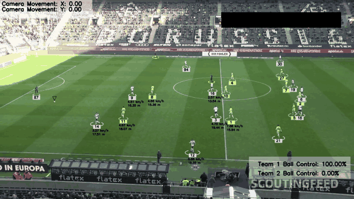
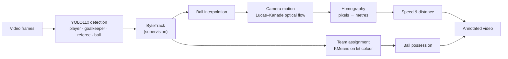
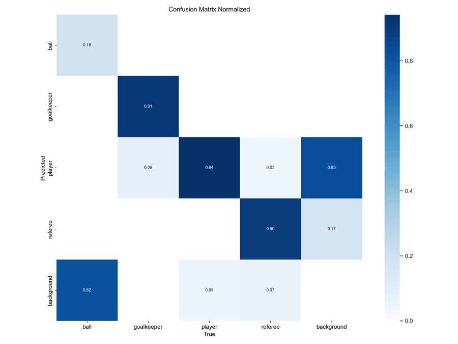
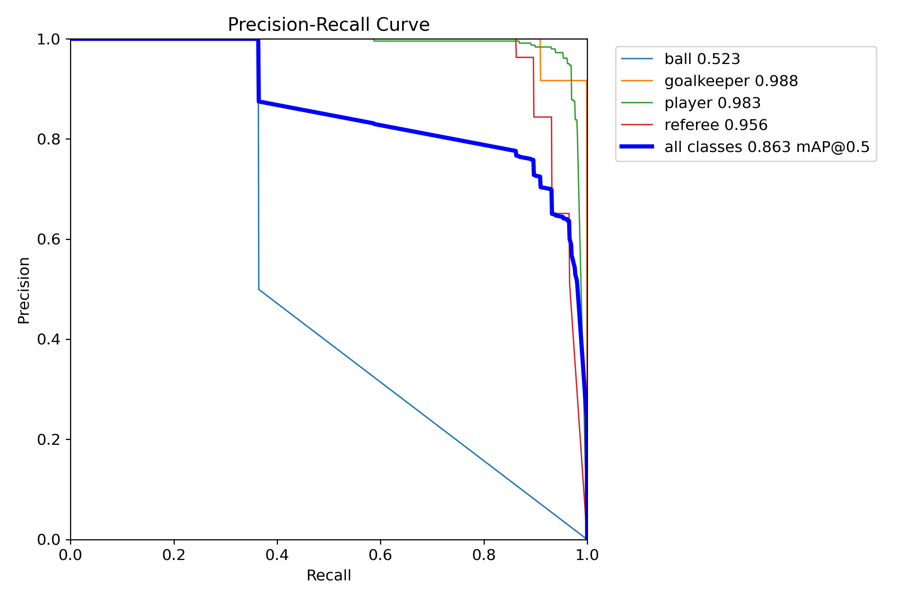

# Automated Soccer Vision

Broadcast football footage goes in, and an annotated video comes out. The pipeline detects and tracks players, referees and the ball. It then splits players into teams by kit colour, works out who has the ball, compensates for camera motion, and projects positions onto the pitch to estimate each player's speed and distance covered in metres.

<p align="center">
  
</p>

This was my Master's capstone (ECE 785, University of Miami, 2025; advisor Dr. Nigel John).

## Credit: what is mine and what is not

The architecture and much of the code follow Abdullah Tarek's
**[football_analysis](https://github.com/abdullahtarek/football_analysis)** tutorial. The module layout, the ByteTrack integration, the KMeans kit-colour clustering, the Lucas–Kanade camera estimator and the perspective transform all come from it. I rebuilt the pipeline step by step from the tutorial, then changed the following:

- **Detector.** I fine-tuned **YOLO11x** on Google Colab and evaluated it (below). The tutorial uses YOLOv5.
- **Ball handling.** Ball positions are interpolated *before* camera compensation and the pitch projection, so the ball also gets adjusted, pitch-space coordinates.
- **Possession.** The ball-to-player assignment threshold is 20 px instead of 70.
- **Clip-specific corrections.** A few referees are detected as players, and one goalkeeper's kit doesn't match his team. I fixed these with manual track-ID overrides, which are declared as constants in [`main.py`](main.py). They are only valid for the sample clip (see *Limitations*).
- **Robustness and drawing.** These are small fixes: integer casts for OpenCV drawing with float coordinates, a guard against division by zero in the speed estimate, skipping tracks without a position, and label placement.
- **Packaging.** I added a CLI, a stub-only mode so the pipeline runs without weights, and published weights with a reproducible evaluation.

## Pipeline



| Stage | How |
|---|---|
| Detection | YOLO11x, confidence 0.1, batches of 20 frames. Goalkeepers are merged into *player* for tracking. |
| Tracking | ByteTrack (`supervision`), with persistent IDs across frames. |
| Ball | Detected separately, gaps filled by linear interpolation (`pandas`). |
| Teams | KMeans (k=2) on the top half of each player crop separates shirt from background. A second KMeans on the first frame's shirt colours gives the two teams. |
| Camera motion | Shi–Tomasi features in two fixed vertical strips of the frame, tracked with pyramidal Lucas–Kanade. Player positions are shifted by the estimated camera movement. |
| Pitch projection | A perspective transform from 4 hand-picked pixel points to a 68 m × 23.32 m section of the pitch. |
| Speed / distance | Displacement in pitch coordinates over 5-frame windows at 24 fps. |

## Detector: training and evaluation

**Data.** The model is trained on [football-players-detection](https://universe.roboflow.com/roboflow-jvuqo/football-players-detection-3zvbc/dataset/1) (Roboflow Universe, v1, CC BY 4.0). It has 4 classes (ball, goalkeeper, player, referee) and 1920×1080 Bundesliga frames, split 612 train / 38 val / 13 test.

**Training.** YOLO11x is fine-tuned from the COCO-pretrained checkpoint with Ultralytics 8.3.91 on Colab: 100 epochs, 640 px, batch 8, default optimizer settings.

**Evaluation.** These are the weights in the release, evaluated with `yolo val` at 640 px. The val split was used to select the checkpoint, so the 13-image **test** split is the held-out number. It is a small sample, so treat it as indicative.

| Split | P | R | mAP50 | mAP50-95 |
|---|---:|---:|---:|---:|
| val (38 images) | 0.963 | 0.758 | 0.863 | 0.631 |
| **test (13 images)** | **0.949** | **0.795** | **0.863** | **0.645** |

Per class, on test:

| Class | P | R | mAP50 | mAP50-95 |
|---|---:|---:|---:|---:|
| player | 0.950 | 0.962 | 0.983 | 0.811 |
| goalkeeper | 0.916 | 0.995 | 0.988 | 0.825 |
| referee | 0.930 | 0.897 | 0.956 | 0.670 |
| ball | 1.000 | 0.327 | 0.523 | 0.274 |

People are detected reliably. The ball is the weak point: it is a few pixels wide at 1080p and blurs when kicked, so recall is low. That is why the pipeline interpolates ball positions between detections.

<p align="center">
  
  
</p>

I also ran a longer YOLO11x run at 832 px (AdamW, lr0 0.002, AMP, batch 8) on a Colab T4. Its best validation epoch reached mAP50 0.866 / mAP50-95 0.649, but the run was set to 300 epochs and stopped at epoch 184, so it never got a final evaluation, and its weights are not the ones used here. The full log is in [`training/train_yolo11x.ipynb`](training/train_yolo11x.ipynb).

## Running it

Requires Python 3.10+ (tested on 3.12, CPU).

```bash
pip install -r requirements.txt
```

1. Download the sample clip used in the tutorial ([Google Drive link from the tutorial](https://drive.google.com/file/d/1t6agoqggZKx6thamUuPAIdN_1zR9v9S_/view?usp=sharing)) and save it as `input_videos/08fd33_4.mp4`. It comes from the Kaggle *DFL – Bundesliga Data Shootout* dataset, so it isn't redistributed here.
2. Run from the cached tracks. No weights are needed, and it takes about a minute on CPU:

   ```bash
   python main.py --use-stubs --output output_videos/demo.avi
   ```

3. Or run detection from scratch with the released weights (114 MB):

   ```bash
   gh release download v1.0 -p best.pt -D models      # or download it from the Releases page
   python main.py --output output_videos/full.avi
   ```

`--input` takes any other clip. On a new video, set the clip-specific constants at the top of `main.py` to empty, and re-pick the four homography points in `view_transformer/view_transformer.py`.

### Training

[`training/train_yolo11x.ipynb`](training/train_yolo11x.ipynb) downloads the dataset from Roboflow. Set your own API key first, with `export ROBOFLOW_API_KEY=...` or, on Colab, the *Secrets* panel.

## Limitations

- **Clip-specific overrides.** The referee and goalkeeper track IDs in `main.py` were picked by hand for the sample clip and its cached tracks. A general solution would detect referees reliably, and handle goalkeepers as a third colour cluster or by pitch position.
- **Fixed homography.** The four reference points are hand-picked for one camera angle. Strong pans or zooms break the metric estimates. There is no camera calibration or automatic pitch keypoint detection.
- **Team assignment.** It is fitted once on the first frame, so it assumes clearly distinct kits and stable lighting.
- **Ball.** Interpolation is linear, so passes and deflections between detections are smoothed out.
- **Tiny evaluation set.** 13 test images is enough to compare classes, but not to make strong claims about generalisation.

Future work from the capstone report: action and event detection, player re-identification across cameras, a match timeline, and more training data via active learning.

## Repository layout

```
main.py                         pipeline entry point (CLI)
trackers/                       YOLO detection + ByteTrack, ball interpolation, drawing
team_assigner/                  kit-colour clustering
player_ball_assigner/           ball possession
camera_movement_estimator/      Lucas–Kanade camera motion
view_transformer/               perspective transform to pitch coordinates
speed_and_distance_estimator/   speed and distance from pitch coordinates
development_and_analysis/       notebook used to develop the colour clustering
training/train_yolo11x.ipynb    YOLO11x fine-tuning (832 px run, with log)
stubs/                          cached tracks and camera movement for the sample clip
input_videos/                   put the sample clip here (see above)
```
