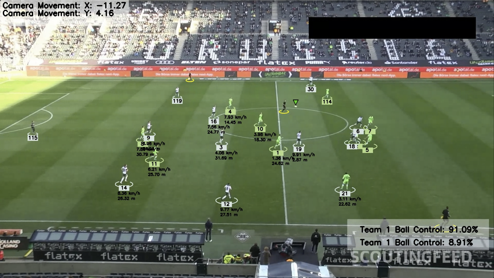

# Automated Soccer Match Analysis with YOLOv11

Capstone project for ECE 785 (University of Miami). The system takes single-camera broadcast footage of a soccer match and produces an annotated video with player and ball tracking, team assignment, ball possession, and per-player speed and distance.

<p align="center">
  
</p>

## Credits

The structure of the analysis pipeline (tracker, team assigner, camera movement estimator, view transformer, speed/distance estimator) follows the public tutorial **[football_analysis](https://github.com/abdullahtarek/football_analysis) by Abdullah Tarek**. The dataset is the [Football Players Detection dataset](https://universe.roboflow.com/roboflow-jvuqo/football-players-detection-3zvbc/dataset/1) on Roboflow Universe.

## What I did

- **Fine-tuned YOLOv11x** (Ultralytics) on the Roboflow dataset for 4 classes: player, goalkeeper, referee, ball. I used it instead of the older YOLO models from the tutorial and compared it against a YOLOv5l baseline.
- **Ran hyperparameter experiments**: default vs. AdamW optimizer, `lr0=0.002` with final LR factor `0.01`, a 3-epoch warm-up, mixed precision (AMP), and different image sizes (640 / 832), batch sizes and epoch budgets.
- **Plugged the fine-tuned detector into the full pipeline** and evaluated it end to end on match footage.
- **Wrote the capstone report** covering the method, the experiments and their limitations.

## Results

Best fine-tuned YOLOv11x run, on the validation split (38 images, 905 objects):

| Metric | Value |
|---|---|
| mAP@50 | **0.866** |
| mAP@50-95 | **0.649** |
| Precision | 0.970 |
| Recall | 0.752 |

Run configuration: YOLOv11x (COCO-pretrained), AdamW, `lr0=0.002`, `lrf=0.01`, 3 warm-up epochs, AMP, image size 832, batch 8, on a Colab GPU. The run was set to 300 epochs and stopped at epoch 184 when the Colab session ended; the numbers above are the best validation epoch. The full training log is in [`training/train_yolo11x.ipynb`](training/train_yolo11x.ipynb).

The ball is the hardest object to detect: it covers only a few pixels and is often motion-blurred.

## Pipeline

1. **Detection**: fine-tuned YOLOv11x finds players, goalkeepers, referees and the ball.
2. **Tracking**: ByteTrack (via `supervision`) keeps object IDs stable across frames.
3. **Team assignment**: K-Means on jersey colors splits players into two teams.
4. **Ball interpolation**: missing ball detections are filled with pandas interpolation.
5. **Camera movement**: Lucas-Kanade optical flow compensates for camera panning.
6. **View transformation**: a perspective transform maps pixels to field coordinates in meters.
7. **Stats**: speed, distance covered and team ball possession are drawn on the output video.

## Getting started

```bash
pip install -r requirements.txt
```

The repo does not include model weights or videos because they are too large for git.

- Put an input clip in `input_videos/`. The original project used a clip from the Kaggle *DFL – Bundesliga Data Shootout* dataset.
- Put trained weights in `models/` (for example `models/yolo11x_epochs100_batch8/best.pt`), or train your own with the notebook below.
- Update the paths at the top of `main.py` if needed, then run:

```bash
python main.py
```

The annotated video is written to `output_videos/`. Intermediate tracking results are cached in `stubs/`.

### Training

The training notebook downloads the dataset from Roboflow. Set your own API key as an environment variable first:

```bash
export ROBOFLOW_API_KEY=your_key_here
```

On Colab, set `os.environ["ROBOFLOW_API_KEY"]` in a cell, or use Colab's *Secrets* panel.

## Repository structure

```
main.py                          # end-to-end pipeline
trackers/                        # YOLO detection + ByteTrack tracking, drawing
team_assigner/                   # K-Means jersey color clustering
player_ball_assigner/            # ball possession
camera_movement_estimator/       # optical-flow camera compensation
view_transformer/                # pixel -> field coordinates
speed_and_distance_estimator/    # per-player speed and distance
utils/                           # video I/O, bbox helpers
training/train_yolo11x.ipynb     # YOLOv11x fine-tuning
development_and_analysis/        # color clustering exploration
```

## Tech stack

Python, Ultralytics YOLOv11, supervision (ByteTrack), OpenCV, scikit-learn, NumPy, pandas, Roboflow.
